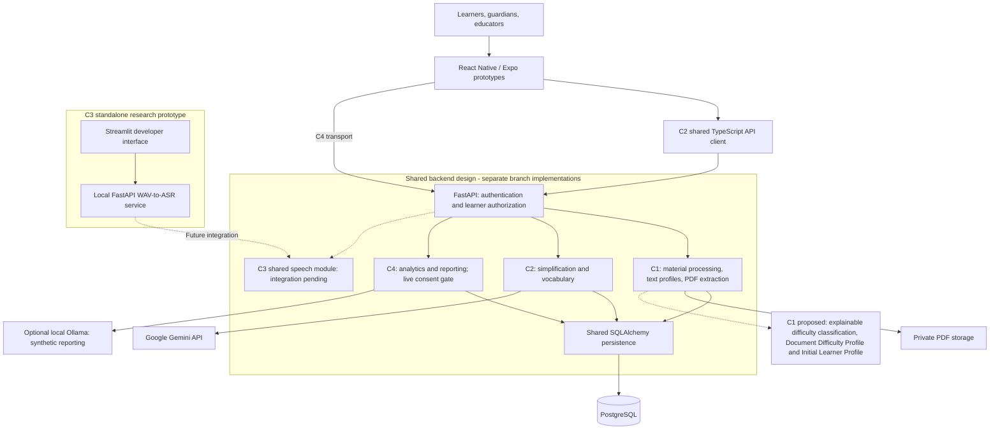

# ReadBuddy

**Adaptive NLP-Based Speech & Reading Assistant for Children with Dyslexia**

**Project ID:** J26-IT-354
**Project type:** University research and software engineering

ReadBuddy explores how accessible content, adaptive text simplification, oral-reading
support, and understandable learner analytics can help children engage with reading.
The intended users are **children aged 9–12**, including learners with dyslexia,
with guardians and educators supporting their learning.

> **Current status:** The four components are not yet fully integrated.
> Implementations and research prototypes exist in separate development snapshots;
> `main` currently tracks project documentation and `.gitignore`.
> Component features described here do not establish a complete group application,
> production readiness, or validated improvements in reading outcomes.

## Contents

- [Research purpose](#research-purpose)
- [Group contributions](#group-contributions)
- [Architecture](#architecture)
- [Research components](#research-components)
- [Feature status](#feature-status)
- [Technology stack](#technology-stack)
- [Repository structure](#repository-structure)
- [Installation and setup](#installation-and-setup)
- [Environment configuration](#environment-configuration)
- [API overview](#api-overview)
- [Testing](#testing)
- [Research significance and limitations](#research-significance-and-limitations)
- [Privacy and ethics](#privacy-and-ethics)
- [Future improvements](#future-improvements)
- [Documentation](#documentation)

## Research purpose

Unfamiliar vocabulary, complex sentences, and dense passages can make reading
challenging. Fixed support may not suit every learner or text. Oral-reading estimates
and progress scores also need context: transcript differences do not automatically
represent learner errors, and scores from different tasks may not be comparable.

**Aim:** Design and evaluate an adaptive NLP-based speech and reading assistant that
combines accessible materials, reading support, and evidence-informed feedback.

The research objectives are to:

1. Prepare usable English reading materials with traceable extraction and processing.
2. Simplify language while preserving essential meaning and explaining vocabulary.
3. Investigate oral-reading transcription and pronunciation modelling.
4. Summarize progress and explain support suggestions using available evidence.
5. Integrate the components through shared contracts, authorization, and infrastructure.
6. Evaluate usability, technical quality, and educational usefulness responsibly.

Learners are the primary users. Guardians need understandable progress summaries;
educators need contextual observations to guide support choices.

## Group contributions

| Student ID | Component | Component name | Main contribution |
| --- | --- | --- | --- |
| IT22081766 | 1 | Intelligent Reading – Material Processing and Dyslexia-Oriented Difficulty Profiling | Reading-material extraction/cleaning and proposed explainable difficulty and initial learner profiles; current backend foundations, text/PDF processing, and internal OCR review |
| IT23375314 | 2 | Generative AI-Based Adaptive Text Simplification & Vocabulary Support | Gemini adaptation, vocabulary explanations, mobile reading views, and feedback |
| IT23203358 | 3 | Develop an Adaptive Guided Oral Reading and Pronunciation Practice Module | WAV transcription, transcript comparison, and pronunciation-modelling research |
| IT23351790 | 4 | Transparent Learner Model & Adaptive Learning Analytics | Deterministic analytics, explainable tips, dashboards, and constrained reporting |

Component titles and student IDs follow the official Progress Presentation 1 details
provided for this review. Presentation scope describes intended contributions;
implementation claims below remain grounded in component documentation and source.

## Architecture

The shared application design uses one **FastAPI modular monolith** and one
**PostgreSQL application database per environment**. Components 1, 2, and 4 follow
this design in their respective branches. Component 3 remains a separate research
application awaiting integration with the shared speech module.



Solid connections describe documented component arrangements, not a combined release.
Dashed connections indicate proposed work or pending integration. No database integration is claimed
for the standalone speech prototype.

Backend modules communicate through service interfaces and share database
infrastructure. Mobile clients use APIs rather than direct database access.
Research dependencies remain separate from production application dependencies.

The intended group journey is **prepare material → adapt text → practise reading →
review progress → choose future support**. This sequence is a research integration
goal; the automatic flow between components is not implemented.

## Research components

### Component 1 — Intelligent Reading – Material Processing and Dyslexia-Oriented Difficulty Profiling

**Intended PP1 contribution:** Prepare reading materials and explain their difficulty
through text extraction and cleaning, PDF and scanned-image processing, age-specific
vocabulary, lexical, and syntactic analysis, and readability/difficulty profiling.
The proposed outputs are a **Document Difficulty Profile** and an **Initial Learner
Profile**, with explainable difficulty classification and structured information for
the other components.

**Documented implementation:** The backend provides authentication, learner access,
preferences, instructor-observed assessments, English pasted-text processing with
normalization, and machine-readable PDF extraction.

- **Current inputs:** English text, PDFs with embedded text, and instructor observations.
- **Current outputs:** Versioned materials, extraction evidence, descriptive text
  profiles, and assessment records.
- **Proposed work not established as implemented:** Age-specific vocabulary and
  linguistic difficulty analysis, readability scoring, explainable classification,
  and generation of the two named profiles. Existing learner records and text
  measurements are not evidence that these proposed outputs are complete.

OCR database models and internal instructor review/acceptance services exist in the
OCR branch. Production OCR execution and a public OCR workflow remain unavailable.
An `ocr_required` outcome means further processing is needed, not that OCR ran.
Text profiles describe content; they do not determine individual learner suitability.
Automatic delivery of the proposed structured profiles to other components remains
an integration objective.

See the [foundation][foundation], [material processing][materials], and [PDF guide][pdf].

### Component 2 — Generative AI-Based Adaptive Text Simplification & Vocabulary Support

This component adapts English passages for selected support needs and explains
unfamiliar vocabulary through the shared authenticated backend.

- **Inputs:** Passage, learner context, reading level, and simplification strategy.
- **Outputs:** Simplified text, contextual vocabulary, warnings, and a saved session.
- **Interface:** Simplified/Compare views, highlights, explanations, vocabulary practice,
  feedback, and PDF Learning Packs.

Four reading levels and five strategies cover sentence splitting, vocabulary changes,
selective detail reduction, rewriting, and combined transformations. Gemini responses
are validated before persistence. Learner authorization applies to simplification,
explanations, and feedback.

Vocabulary acknowledgements, game scores, and next-level suggestions remain local
state. Automatic difficulty input from Component 1, performance-driven re-adaptation
from Component 3, and persistent profile adaptation through Component 4 are pending.

See the [Component 2 README][c2] and [integration audit][c2-audit].

### Component 3 — Develop an Adaptive Guided Oral Reading and Pronunciation Practice Module

This standalone research prototype explores transcription and pronunciation evidence
before dependable learner feedback can be offered.

- **Inputs:** WAV recordings and target words for optional research comparison.
- **Outputs:** Automatic transcripts and unverified transcript differences.
- **Research:** Speechocean762 experiments, acoustic features, Ridge modelling, and
  seven documented PP1 notebooks.

The supplied README describes a local FastAPI service and a Streamlit developer
interface. It does not identify the ASR model/provider. All five pronunciation scores
and word/phoneme judgments remain unavailable for learner feedback; TTS, adaptive
assistance, and hesitation detection are not established features.

Component 3's source checkout was unavailable for independent inspection. Its supplied
README is the evidence source; its research interface is not a completed mobile workflow.

### Component 4 — Transparent Learner Model & Adaptive Learning Analytics

This component turns recorded reading evidence into understandable progress views
and explainable support suggestions.

- **Inputs:** Word counts, active duration, available hesitation counts, history,
  preferences, and reading context.
- **Outputs:** Accuracy, pace, supported trends, advisory tips, and progress reports.
- **Interface:** Learner profiles/results, guardian/educator dashboards, settings,
  and PDF/browser report exports.

Core metrics and tips are deterministic. Optional local Ollama reporting is separate
and constrained by validated evidence. Missing measurements remain unavailable,
and suggestions do not automatically change reading settings.

Offline synthetic demos and an authenticated Connected PP1 persistence demonstration
are documented. Production routes exist, but consent remains deny-by-default.
Fictional sample storage is separate from production session records.

See the [Component 4 README][c4] and [saved-progress guide][c4-saved].

## Feature status

**Implemented** means documented behavior within its component source.
**Prototype** means a bounded research/demo implementation, not production validation.

| Area | Capability | Status / boundary |
| --- | --- | --- |
| Shared / C1 | Authentication, learner access, observations, text/PDF processing | Implemented in backend branches |
| C1 | OCR review and execution | Internal review implemented; production execution pending |
| C1 | Age-specific analysis, readability/difficulty classification, Document Difficulty Profile, Initial Learner Profile | Proposed PP1 scope; implementation not established by reviewed documentation |
| C1 → other components | Structured profile handoff | Not yet integrated |
| C2 | Simplification, vocabulary, reading views, feedback | Implemented within the component |
| C2 | Vocabulary practice and level suggestions | Prototype; local state |
| C3 | Transcription and transcript comparison | Standalone research prototype |
| C3 | Reliable learner pronunciation feedback | Unavailable; further validation required |
| C4 | Analytics, tips, dashboards, reporting | Synthetic/connected prototype; live consent gate closed |
| Group | Automatic adaptive reading workflow | Not yet integrated |

## Technology stack

| Layer | Documented technologies |
| --- | --- |
| Mobile | React Native, Expo, TypeScript, Expo Print/Sharing |
| Backend | Python 3.13 shared foundation, FastAPI, Pydantic, Uvicorn |
| Persistence | PostgreSQL, SQLAlchemy, psycopg, Alembic |
| Content / AI | `pypdf`, Gemini via `httpx`, optional local Ollama/Qwen3:4B |
| Speech research | Python, FastAPI, Streamlit, notebooks, Ridge modelling, Speechocean762 |
| OCR research | Tesseract and PaddleOCR; isolated evaluation |
| Security | JWT, Argon2 password hashing, learner authorization, Expo SecureStore |
| Development / checks | `uv`, pnpm (C2), Yarn (C4), Docker Compose, GitHub Actions, pytest, Ruff, mypy, TypeScript, Node tests, Jest/ESLint |

C3's Python version and ASR engine are unspecified in its supplied README.
Tooling and lockfiles differ between component snapshots.

## Repository structure

`main` tracks `README.md` and `.gitignore`. The following concise layout exists
in inspected development/component snapshots and has not been merged into `main`:

```text
apps/
├── backend/          # FastAPI modules, migrations, tests, environment example
└── mobile/           # Foundation placeholder or C2/C4 Expo implementation
packages/
└── api-client/       # C2 TypeScript transport; placeholder in other snapshots
docs/                 # Architecture, API, setup, and integration guides
research/             # Isolated experiments and evaluation
scripts/              # Backend quality checks
.github/              # CI and review configuration
compose.yaml          # Local backend/database foundation
```

C2 has a root pnpm workspace; C4 has `apps/mobile/yarn.lock`.
C3 documents `backend/`, `frontend/`, and `notebooks/` in its separate checkout.
Local dependency/cache directories are not evidence of available application source.

## Installation and setup

### Select a source checkout

There is no single runnable group installation on `main`.
Clone the repository, then obtain the appropriate component/development checkout
and use that checkout's instructions and lockfiles:

```sh
git clone https://github.com/Chamudika07/J26-IT-354-Adaptive-NLP-Based-Speech-Reading-Assistant.git
cd J26-IT-354-Adaptive-NLP-Based-Speech-Reading-Assistant
```

Shared development requires Python 3.13, `uv`, and PostgreSQL, or Docker Compose
for the backend foundation. Mobile prototypes require Node.js and Expo-compatible
device/simulator tooling. Authenticated demonstrations need provisioned synthetic accounts.

### Shared backend

In a foundation checkout, configure the environment and database using the
[foundation setup][foundation]. Then, from that checkout:

```sh
cd apps/backend
uv sync --locked
# After reviewing the branch history and verifying the development database:
uv run --locked alembic upgrade head
uv run --locked uvicorn app.main:create_app --factory --reload --no-access-log
```

The foundation Swagger UI is `http://127.0.0.1:8000/docs`.
The linked guide covers Docker Compose, database creation, and credentials.
PDF operations additionally require the private storage setup in the [PDF guide][pdf].
Do not combine component migration histories without integration review.

### Component 2 mobile prototype

Follow the [C2 setup][c2] for backend/Gemini configuration and its documented port 8001.
From the C2 repository root:

```sh
pnpm install --frozen-lockfile
pnpm --filter @readbuddy/mobile start
```

Set the mobile API address and configure an authorized synthetic session.
Physical devices need a reachable host address, not `localhost`.
The disabled AI provider returns HTTP 503 until live Gemini is configured.

### Component 4 prototype

From its checkout root:

```sh
yarn --cwd apps/mobile install --frozen-lockfile
yarn --cwd apps/mobile start:go
```

Begin with Demo Mode. Connected PP1 has separate database/account/allowlist requirements:
follow the [standalone setup][c4-setup] and [saved-progress guide][c4-saved].

### Component 3 research application

Use its `LAPTOP_SETUP.md`, `backend/API.md`, and `frontend/README.md`.
The supplied README documents `run.bat` on the configured Windows laptop and
`python frontend/run_streamlit.py` for the developer interface at port 8501.
Its local FastAPI service uses port 8000, which can conflict with the shared backend.
No verified repository link for that separate checkout was supplied.

## Environment configuration

Use the selected checkout's `.env.example` files or exported variables.
Configuration falls into four groups:

- **Database:** `DATABASE_URL`, optional migration-role URL, and Compose settings.
- **Identity:** `JWT_SIGNING_KEY` and documented token/session settings.
- **Features:** Private PDF storage, C2 Gemini provider/key/model, and C4 demo settings.
- **Client:** The appropriate backend address; C2 uses `EXPO_PUBLIC_API_BASE_URL`.

Keep backend secrets out of mobile bundles. Replace example placeholders privately;
never commit real `.env` files. Detailed variables, storage permissions, provider
options, and demo provisioning remain in the linked component guides.

## API overview

The shared API prefix is `/api/v1`. Clients authenticate with bearer tokens;
services validate requests and enforce learner access before processing content.

| Method | Path after `/api/v1` | Purpose |
| --- | --- | --- |
| GET | `/health`, `/health/ready` | Liveness and database connectivity |
| POST | `/auth/login`, `/auth/refresh`, `/auth/logout` | Authentication lifecycle |
| GET | `/learners/{learner_id}` | Authorized learner information |
| POST | `/simplification/{learner_id}/simplify` | C2 text adaptation and vocabulary |
| POST | `/simplification/{learner_id}/vocabulary/explain` | C2 contextual explanation |
| GET | `/learner-modelling/learners/{learner_id}/progress` | C4 consent-protected progress boundary |

These routes belong to their corresponding source snapshots. A learner UUID alone
is not authorization. Full schemas and additional routes belong in the
[authentication guide][auth], [C2 README][c2], and [C4 router][c4-router].

## Testing

Run checks only in the matching checkout. From the foundation root:

```sh
sh scripts/check_backend.sh
```

This runs dependency synchronization, Ruff lint/format checks, mypy, and pytest.
Database-dependent tests require explicit disposable-database configuration and may
reset tables; follow the [database testing guide][database] before running them.

Representative mobile checks, each from its own component checkout:

```sh
# Component 2
pnpm --filter @readbuddy/mobile test
pnpm --filter @readbuddy/mobile typecheck
pnpm --filter @readbuddy/api-client typecheck
# Component 4
yarn --cwd apps/mobile test
yarn --cwd apps/mobile typecheck
yarn --cwd apps/mobile lint
```

C3 documents `.venv/Scripts/python.exe -m pytest backend/tests -q -p no:cacheprovider`.
Component guides contain focused backend tests, Expo checks, and research procedures.
These commands are guidance, not claims of a fresh successful test run.

## Research significance and limitations

The project connects four complementary research questions: dependable content
preparation, meaning-preserving adaptation, useful oral-reading evidence, and
explainable progress support. Expected outputs include an integrated prototype,
reproducible evaluations, and findings about usability and educational usefulness.

Important evidence boundaries are:

- **C2:** Generated output needs independent readability and meaning-preservation
  evaluation. Mocked provider tests do not establish live educational quality.
- **C3:** Ages 9–12 validation includes only 100 recordings from five speakers.
  Target-age failures and the completeness ceiling prevent dependable individual
  pronunciation feedback. The official Speechocean762 test remains unevaluated;
  no dyslexia-specific validity or validated reading-error accuracy is claimed.
- **C4:** Synthetic demonstrations do not establish outcomes for children.
  Metrics require comparable context; absent measurements remain unavailable.
  Recommendations stay advisory, and saved AI snapshots are not fresh model runs.
- **Group:** Improved confidence, comprehension, and independence remain intended
  benefits to investigate, not experimentally established group outcomes.

## Privacy and ethics

Use synthetic accounts and learner data in development and demonstrations.
Protect recordings, reading content, datasets, credentials, and database exports;
collect only necessary information and keep protected data out of Git and logs.

Authentication does not establish consent. C2's authorization reports consent as
unevaluated; C4 production access remains deny-by-default pending shared consent
integration. Participant research requires appropriate permissions, assent where
applicable, withdrawal procedures, and separate approval for research reuse.

Enabling Gemini sends submitted text to Google. C2 retains generated results and
feedback but stores source length/hash rather than raw source text; this does not
mean C1 reading materials are never stored. Optional C4 AI reporting is local.

ReadBuddy is an educational research aid, not a diagnostic tool or clinically
validated intervention. Dataset use must respect its research and licensing boundaries.

## Future improvements

- Reconcile migrations, API contracts, and client transports for group integration.
- Complete OCR execution/review and connect trustworthy content and reading evidence.
- Validate NLP and speech outputs before using them for automatic adaptation.
- Improve accessibility and test device networking, reporting, and interaction flows.
- Complete consent, provisioning, retention, withdrawal, and deployment requirements.
- Evaluate the integrated workflow through an appropriate participant research protocol.

## Documentation

Links below point to inspected repository snapshots because these files are absent
from `main`. Official titles, IDs, and intended Component 1 scope follow the PP1
details supplied for this review; the four component READMEs and inspected source
remain the implementation references. No presentation file or public link was supplied.

| Reference | Details retained outside this overview |
| --- | --- |
| [Foundation][foundation] and [architecture][architecture] | Backend setup and shared design |
| [Database][database] and [authentication][auth] | Migration/testing procedures and access policies |
| [Materials][materials] and [PDF extraction][pdf] | Processing contracts and private storage |
| [OCR guide][ocr] and [service source][ocr-service] | Review phases and internal implementation |
| [Component 2][c2] and [integration audit][c2-audit] | Strategies, API/configuration details, tests, and gaps |
| [Component 4][c4], [setup][c4-setup], and [saved progress][c4-saved] | Demo modes, provisioning, and persistence |
| [Research governance][research] | Experiment separation and data boundaries |

Older guides describe earlier stages: the OCR Phase 1 guide predates internal
acceptance services, and C4's older handoff predates its consent-protected routes.
Use the linked component README and source together when assessing current behavior.
C3's standalone guides are referenced by name because its repository URL is unavailable.

Contributors should follow the selected checkout's [contribution workflow][contributing]
and engineering rules, preserve component documentation, and coordinate shared changes.
No project license has yet been specified in the inspected snapshots.

[foundation]: ../../blob/b6cbf00362a595434e9727636745a9f0b77dfb95/README.md
[architecture]: ../../blob/b6cbf00362a595434e9727636745a9f0b77dfb95/docs/foundation.md
[database]: ../../blob/b6cbf00362a595434e9727636745a9f0b77dfb95/docs/database-sprint-1.md
[auth]: ../../blob/b6cbf00362a595434e9727636745a9f0b77dfb95/docs/auth-authorization-foundation.md
[materials]: ../../blob/b6cbf00362a595434e9727636745a9f0b77dfb95/docs/reading-material-processing.md
[pdf]: ../../blob/b6cbf00362a595434e9727636745a9f0b77dfb95/docs/pdf-text-extraction.md
[ocr]: ../../blob/39496b5c4dc2834f17a9df073489052bb5826a6f/docs/ocr-review-workflow.md
[ocr-service]: ../../blob/39496b5c4dc2834f17a9df073489052bb5826a6f/apps/backend/app/modules/reading_materials/ocr/service.py
[c2]: ../../blob/05155670f38231a38813a8c5d28a16d0ce940b82/README.md
[c2-audit]: ../../blob/05155670f38231a38813a8c5d28a16d0ce940b82/docs/component-2-integration-audit.md
[c4]: ../../blob/6137fa1ce2ce5fd7738f4adc4360f55bde1edb36/README.md
[c4-setup]: ../../blob/6137fa1ce2ce5fd7738f4adc4360f55bde1edb36/docs/component-4-standalone-pp1-setup.md
[c4-saved]: ../../blob/6137fa1ce2ce5fd7738f4adc4360f55bde1edb36/docs/component-4-pp1-saved-progress.md
[c4-router]: ../../blob/6137fa1ce2ce5fd7738f4adc4360f55bde1edb36/apps/backend/app/modules/learner_modelling/router.py
[research]: ../../blob/b6cbf00362a595434e9727636745a9f0b77dfb95/research/README.md
[contributing]: ../../blob/b6cbf00362a595434e9727636745a9f0b77dfb95/CONTRIBUTING.md
