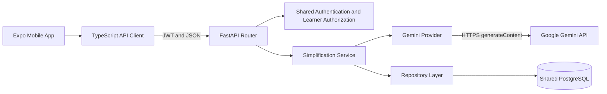
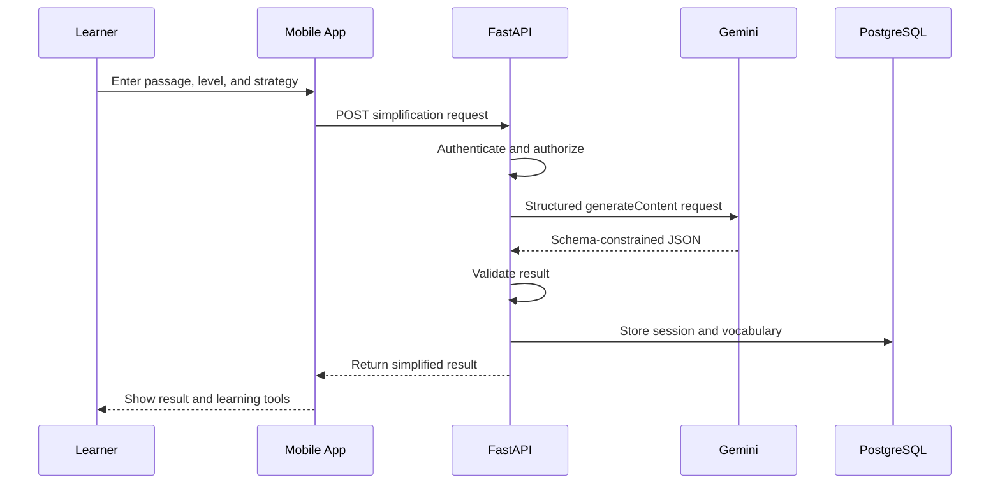

# ReadBuddy Component 2

## Generative AI-Based Adaptive Text Simplification and Vocabulary Support

**Project:** J26-IT-354 — Adaptive NLP-Based Speech and Reading Assistant

**Branch:** `feat/component-2-simplification`

**Target users:** Children aged 9–12, including learners with dyslexia

Component 2 converts an English passage into a more accessible version and provides
contextual vocabulary support. It is an educational reading aid; it does not diagnose
dyslexia or measure intelligence or reading ability.

## Problem statement and objectives

Children with dyslexia may find unfamiliar vocabulary, long sentences, or dense
explanations difficult to process. A fixed simplification method may also be unsuitable
for every passage or learner.

This component aims to:

- simplify text for a selected qualitative reading-support level;
- apply an explicit transformation strategy while retaining essential facts;
- identify difficult words and explain them in child-friendly language;
- support comparison, revision, feedback, and vocabulary practice;
- integrate safely with shared authentication and learner authorization; and
- minimize retained source data while documenting external AI processing.

## Implemented features

### Adaptive text simplification

- Reading levels: `beginner`, `elementary`, `intermediate`, and `advanced`.
- Strategies:

| Strategy | Main behavior |
| --- | --- |
| `sentence_split` | Split long sentences while preserving wording and order where practical |
| `vocabulary_swap` | Replace difficult words while retaining structure and key terminology |
| `concept_reduction` | Remove repetition and non-essential detail while retaining key concepts |
| `full_rewrite` | Permit broader restructuring while preserving essential facts |
| `combined` | Combine sentence, vocabulary, and selective detail simplification |

- Explicit strategy and reading-level instructions in the Gemini prompt.
- Schema-constrained JSON output validated with Pydantic.
- Rejection of malformed output or conflicting requested strategy/level metadata.
- Sanitized provider errors, timeouts, rate-limit handling, and bounded retries.

### Mobile reading experience

- Child-friendly home screen and guided reading workflow.
- Passage entry and three bundled synthetic sample stories.
- **Simplified Only** and vertically stacked **Compare** views.
- Exact original-passage display, including whitespace and line breaks.
- Local yellow change highlights and blue vocabulary highlights.
- Vocabulary cards with definitions, optional examples and synonyms, detailed
  explanations, and temporary **Got it!** acknowledgement.
- Feedback signals: `too_hard`, `just_right`, `too_easy`, and `skipped`.
- Optional learner-controlled level suggestion for the next passage.
- Local PDF Learning Pack preview, printing, sharing, and saving.
- Vocabulary Adventure with 3–5 deterministic questions grounded in returned
  vocabulary.
- Loading, empty, error, retry, cancellation, and insufficient-vocabulary states.

Acknowledgements, game scores, and level suggestions are temporary mobile state. They
are not persistent learning analytics or evidence of mastery.

### Authentication

- Learner-scoped authorization for simplification, explanations, and feedback.
- Access tokens remain in memory.
- Rotating refresh token, learner UUID, and optional API address use Expo SecureStore.
- Concurrent expired requests share one refresh operation and retry once.
- Invalid refresh sessions are cleared rather than retried indefinitely.

## System architecture

Component 2 is part of the shared FastAPI modular monolith and PostgreSQL database. It
does not create a separate backend or application database.



The mobile application uses state-driven screens in `apps/mobile/App.tsx`. Network
operations pass through the shared TypeScript client, ensuring consistent request,
error, authentication, and token-refresh behavior.

The backend service authorizes the learner, invokes the configured provider, validates
the result, and persists the session in one transaction. The migration creates:

- `simplification_sessions` for generated text and session/provider metadata;
- `simplification_vocabulary` for automatic and requested explanations; and
- `simplification_feedback` for append-only feedback.

## Frontend-to-backend communication

1. The app validates the learner/session context.
2. It sends a typed request with the learner UUID in the URL.
3. The shared client adds the bearer access token.
4. On `401 authentication_required`, it can refresh once and retry once.
5. FastAPI authenticates the user and verifies access to the learner.
6. The validated response is returned to the current mobile result state.

A learner UUID is not authorization by itself; an authenticated learner relationship
is required.

## Main API endpoints

All routes use the `/api/v1` prefix.

| Method | Endpoint | Purpose |
| --- | --- | --- |
| `POST` | `/simplification/{learner_id}/simplify` | Simplify text and return vocabulary |
| `POST` | `/simplification/{learner_id}/vocabulary/explain` | Explain a word or phrase in context |
| `POST` | `/simplification/{learner_id}/sessions/{session_id}/feedback` | Store session feedback |

Supporting authentication routes are `/auth/login`, `/auth/refresh`,
`/auth/logout`, and `/auth/me`.

The mobile simplification request supplies `source_text`,
`target_reading_level`, and `preferred_strategy`. The response includes simplified
text, applied metadata, vocabulary items, warnings, timestamps, and a persisted session
identifier.

Optional schema fields for future integration include source/document difficulty,
document ID, key concepts, and current reading level. The mobile app does not
automatically obtain these values from other components.

## Gemini AI integration

The provider is implemented with `httpx` and Google's REST API.

| Setting | Repository implementation |
| --- | --- |
| Provider | Google Gemini |
| Default model | `gemini-3.5-flash-lite` |
| API version | `v1beta` |
| Operation | `models/{model}:generateContent` |
| Response | `application/json` with a response schema |
| Temperature | `0.2` |
| Default timeout/retries | 30 seconds / 1 retry |

Runtime environment variables may override the model, base URL, timeout, and retry
count. The API key is read only by the backend, sent in the provider request header,
and never placed in the mobile bundle or returned by the API.

The prompt contains educational rules, the required strategy, reading-level guidance,
optional key concepts, and the passage inside untrusted-source delimiters. Provider
responses are parsed and validated before persistence. The reserved OpenAI provider
option has no network implementation and fails closed.

## Adaptive simplification workflow



The original string remains in mobile state for comparison. The API schema trims
surrounding whitespace for processing. Raw source text is not stored in PostgreSQL.

## Vocabulary support workflow

1. Gemini returns suitable difficult terms with simple definitions and optional
   examples/synonyms.
2. The mobile app renders one learning card per item.
3. Selecting a term can call the explanation endpoint with optional context and session
   ID.
4. The backend verifies learner permission and session ownership.
5. The validated explanation is persisted and displayed without replacing the reading
   result.

The local **Got it!** action and Vocabulary Adventure do not submit progress data.

## Technologies and project structure

| Layer | Technologies |
| --- | --- |
| Mobile | React Native, Expo 57, React, TypeScript |
| Mobile security/export | Expo SecureStore, Expo Print, Expo Sharing |
| Shared client | TypeScript, Fetch API, AbortSignal |
| Backend | Python 3.13, FastAPI, Pydantic, SQLAlchemy, Alembic |
| Data and AI | PostgreSQL, `httpx`, Gemini REST API |
| Tooling | pnpm, `uv`, pytest, Ruff, mypy, Node test runner |

```text
apps/
├── backend/
│   ├── app/modules/simplification/    # routes, service, models, provider
│   ├── alembic/versions/              # shared migration history
│   └── tests/
└── mobile/
    ├── assets/home/                   # bundled sample-story artwork
    ├── src/services/api.ts            # auth session and API facade
    ├── tests/component2.test.cjs
    └── App.tsx
packages/api-client/src/               # TypeScript contracts and transport
docs/                                  # shared architecture and audits
```

## Configuration

Use `apps/backend/.env.example` and `apps/mobile/.env.example`. Never commit real
environment files.

| Group | Main variables |
| --- | --- |
| Database | `DATABASE_URL`, optional `MIGRATION_DATABASE_URL` |
| Authentication | `JWT_SIGNING_KEY` and JWT/TTL settings |
| Gemini | `SIMPLIFICATION_AI_PROVIDER`, `SIMPLIFICATION_AI_API_KEY`, `SIMPLIFICATION_AI_MODEL`, timeout/retry/base-URL settings |
| Mobile | `EXPO_PUBLIC_API_BASE_URL` |
| Disposable tests | `TEST_DATABASE_URL`, `ALLOW_TEST_DATABASE_RESET` |

Never place tokens, keys, passwords, or learner identifiers in `EXPO_PUBLIC_*` because
Expo public values are embedded in the bundle.

## Installation and execution

### Prerequisites

- Python 3.13 and `uv`
- Node.js and pnpm
- Native PostgreSQL
- Expo-compatible iOS or Android tooling
- an approved synthetic account and authorized learner relationship
- a Gemini API key for live AI processing

### Backend

```sh
cd apps/backend
uv sync --locked
# Verify DATABASE_URL before running migrations.
uv run --locked alembic upgrade head
uv run --locked uvicorn app.main:create_app \
  --factory --host 0.0.0.0 --port 8001 --no-access-log
```

The default disabled provider returns HTTP 503 for AI operations. Live simplification
requires valid Gemini provider, model, and key settings.

### Mobile

From the repository root:

```sh
pnpm install --frozen-lockfile
pnpm --filter @readbuddy/mobile start
```

A physical phone must use the computer's reachable LAN address rather than
`localhost`. Enter authorized synthetic session details through **Configure Session**.

## Testing

```sh
# Repository root
pnpm --filter @readbuddy/mobile test
pnpm --filter @readbuddy/mobile typecheck
pnpm --filter @readbuddy/api-client typecheck
pnpm --filter @readbuddy/mobile exec expo-doctor

# apps/backend
uv run --locked pytest \
  tests/unit/test_simplification_*.py \
  tests/api/test_simplification_api.py -q
uv run --locked ruff check .
uv run --locked ruff format --check .
uv run --locked mypy
```

Latest verified non-database results:

| Check | Result |
| --- | --- |
| Mobile tests | 87 passed |
| Focused backend tests | 236 passed |
| Mobile and API-client type checks | Passed |
| `git diff --check` | Passed |

The backend tests reported one third-party Starlette/httpx deprecation warning.
Provider tests use mocked responses; these results do not imply a live Gemini request
or PostgreSQL migration validation.

## Integration status

| Dependency | Status |
| --- | --- |
| Shared auth/learner module | JWT authentication, relationships, and learner authorization are integrated |
| Component 1 | Difficulty/key-concept fields exist; automatic input is not integrated |
| Component 3 | Manual feedback is stored; performance-driven re-adaptation is not integrated |
| Component 4 | Local level suggestions exist; persistent profile adaptation is not integrated |
| Shared consent | Consent models exist, but authorization reports `consent_evaluated=False` |

## Privacy, limitations, and future improvements

- Use synthetic passages and accounts; do not use real child data in development.
- Raw source text is not persisted; its length and SHA-256 hash are stored.
- Generated text, vocabulary, and feedback are persisted.
- When Gemini is enabled, submitted text is sent to Google for processing.
- Authorization does not establish active learner or guardian consent.
- Component responses use `Cache-Control: no-store`.
- Never log or commit credentials, tokens, learner content, database dumps, or real
  `.env` files.

The following remain incomplete or planned:

- active, non-withdrawn consent evaluation;
- automatic Component 1, 3, and 4 adaptation pipelines;
- independent readability and semantic/educational correctness validation;
- static baseline and formal comparative research evaluation;
- persistent vocabulary mastery or game-score tracking;
- OpenAI provider network execution; and
- in-app account, relationship, or consent provisioning.

Live generative output is probabilistic. Tests verify contracts, prompt construction,
validation, and error handling; they do not prove that every result is pedagogically
optimal or that each strategy always produces visibly different prose.

## Related documentation

- [Component 2 integration audit](docs/component-2-integration-audit.md)
- [Authentication and authorization](docs/auth-authorization-foundation.md)
- [Learner profile API](docs/learner-profile-api.md)
- [Shared architecture](docs/foundation.md)
- [API client notes](packages/api-client/README.md)
