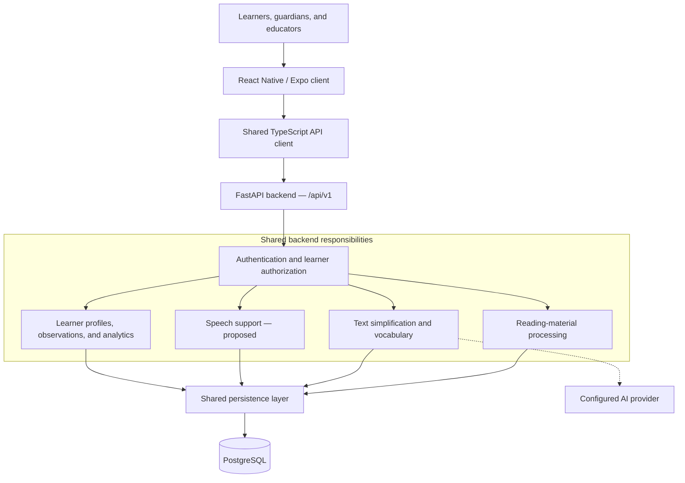

# ReadBuddy

**Adaptive NLP-Based Speech & Reading Assistant for Children with Dyslexia**

**Project reference:** J26-IT-354

## Project overview

ReadBuddy is a university research project exploring how natural language processing
(NLP), speech support, and learner modelling can make reading materials more accessible
to children with dyslexia. The proposed assistant brings together reading-material
processing, adaptive text simplification, vocabulary support, speech-assisted practice,
and understandable progress feedback within a shared application.

The project aims to support learners during reading while helping guardians and
educators understand their progress and choose appropriate support.

> **Project status:** This README describes the overall project vision and proposed
> integrated system. The `main` branch currently contains project-level documentation;
> shared foundations, experiments, and component prototypes are documented on
> development and feature branches. Their presence does not establish a complete,
> integrated application. Proposed capabilities and expected benefits below are not
> claims of completed implementation or validated learning outcomes.

## Problem statement

Unfamiliar vocabulary, long sentences, and dense explanations can make reading
materials difficult for children with dyslexia to engage with. A fixed presentation
or simplification approach may not suit every learner, passage, or reading session.

Support also requires more than an isolated accuracy or reading-speed score. Guardians
and educators need understandable evidence about progress, the conditions under which
a reading task was completed, and the reasons behind suggested support.

ReadBuddy investigates how these needs can be addressed through a connected reading
workflow: preparing content, adapting its presentation and language, supporting reading
practice, and using recorded evidence to inform subsequent support.

## Aim and objectives

**Aim:** To design and evaluate an adaptive speech and reading assistant that combines
NLP-based content support with learner information to improve access to reading
materials for children with dyslexia.

The project objectives are to:

1. Prepare usable reading content from entered text and documents, with extraction
   quality checks and review where needed.
2. Explore text simplification that responds to selected reading-support needs while
   preserving essential meaning and key concepts.
3. Provide contextual vocabulary explanations and accessible reading controls.
4. Investigate speech-assisted reading practice and its integration with the wider
   reading workflow.
5. Use learner preferences and recorded reading evidence to provide transparent
   progress summaries and explainable support suggestions.
6. Evaluate content quality, usability, and the usefulness of adaptive support without
   treating educational observations as medical diagnoses.

## Target users

| User group | Intended benefit |
| --- | --- |
| Children aged 9–12, including learners with dyslexia | More accessible reading materials, vocabulary assistance, and guided reading practice |
| Guardians | Understandable summaries of a child's recorded reading progress and support needs |
| Educators and instructors | Reading observations, contextual progress information, and evidence to guide support choices |

ReadBuddy is intended as an educational aid. It is not a diagnostic tool or a
clinically validated intervention.

## Proposed features

The following capabilities describe the intended project scope. Individual prototypes
and research experiments have different levels of maturity; integration and evaluation
remain ongoing work.

| Feature area | Intended capability |
| --- | --- |
| Reading-material preparation | Accept entered text and PDF content; investigate OCR for scanned or photographed material, with extraction review before use |
| Text profiling | Describe features such as sentence length and vocabulary complexity to inform content processing |
| Adaptive text simplification | Simplify vocabulary and sentence structure for selected support needs while retaining essential facts; allow original and simplified text comparison |
| Vocabulary support | Explain difficult words in context using accessible definitions, examples, and practice activities |
| Accessible reading experience | Offer learner-controlled font size, spacing, and highlighting preferences |
| Speech-assisted practice | Explore speech support and reading-performance capture; the speech implementation and its integration remain to be established |
| Learner profiles and observations | Maintain relevant preferences and recorded reading observations within authorized learner relationships |
| Progress analytics and reporting | Summarize available reading accuracy, pace, and session history while explaining missing evidence and differences between tasks |
| Explainable support suggestions | Present evidence-based reading tips for human review; investigate how feedback can inform later adaptations |

Automatic adaptation across all feature areas is a proposed integration goal.
Existing analytics documentation describes advisory recommendations with
human-controlled settings, rather than automatic changes to a learner's support.

## High-level system architecture

The documented architecture uses one client application, one shared FastAPI backend
organized into feature modules, and one PostgreSQL application database per environment.
The diagram shows the intended integrated structure, including proposed modules.

Backend modules communicate through defined service interfaces and use shared database
infrastructure. The client accesses the backend API rather than the database directly.
Research experiments remain separate from application code until reviewed and integrated.

The intended learning flow is to prepare reading material, select suitable support,
present the reading activity, collect available observations and feedback, and review
progress to guide future support. Connecting these stages into a complete adaptive
workflow remains an integration objective.

## Technology stack

These technologies are documented in the development foundation and feature branches;
this table does not imply that their application code is available on `main`.

| Layer | Documented technology and role |
| --- | --- |
| Client application | React Native, Expo, and TypeScript for mobile interfaces and component prototypes |
| API communication | Shared TypeScript client communicating with FastAPI REST endpoints |
| Backend | Python, FastAPI, and Pydantic for application services and validated API contracts |
| Persistence | PostgreSQL, SQLAlchemy, psycopg, and Alembic for shared storage and schema migrations |
| Document processing | `pypdf` for machine-readable PDF extraction; Tesseract and PaddleOCR investigated in separate OCR experiments |
| Text adaptation | Google Gemini API integration documented in the simplification prototype; generated content still requires quality evaluation |
| Learner analytics | Deterministic Python calculations and rule-based suggestions; optional Ollama-based reporting explored separately in the analytics prototype |
| Development and verification | `uv`, pytest, Ruff, mypy, TypeScript checks, and branch-specific mobile tests; Docker Compose for the documented local backend foundation |

Speech technologies and final choices for the integrated application are not established
by the reviewed documentation. Experimental tools and component-specific providers
should not be read as mandatory dependencies for every part of the system.

## Expected outcomes

The project is expected to produce:

- An integrated research prototype demonstrating a supported reading journey from
  content preparation to progress review.
- More accessible versions of reading materials with contextual vocabulary assistance.
- Learner-facing reading support and understandable progress information for guardians
  and educators.
- Explainable suggestions grounded in recorded evidence and learner preferences.
- Evaluation findings on extraction quality, meaning preservation, usability, and the
  usefulness of adaptive support, including limitations and integration gaps.

Improved reading confidence, comprehension, and independence are intended benefits to
investigate. They have not been established by component demonstrations or automated
software tests. Participant evaluation requires appropriate consent and research
governance; development documentation specifies synthetic data for demonstrations.

## Documentation basis

This overview draws on the repository's locally available branch documentation:

- `develop`: root README, `docs/foundation.md`, reading-assessment and
  reading-material-processing guides, mobile notes, and OCR research documentation.
- `origin/feat/component-2-simplification`: adaptive text simplification, vocabulary
  support, and integration limitations documented in its README.
- `origin/feat/component-4-learner-analytics`: learner analytics, reporting, and
  human-controlled support recommendations documented in its README.

Consult the relevant branch documentation for component-specific setup and status.
